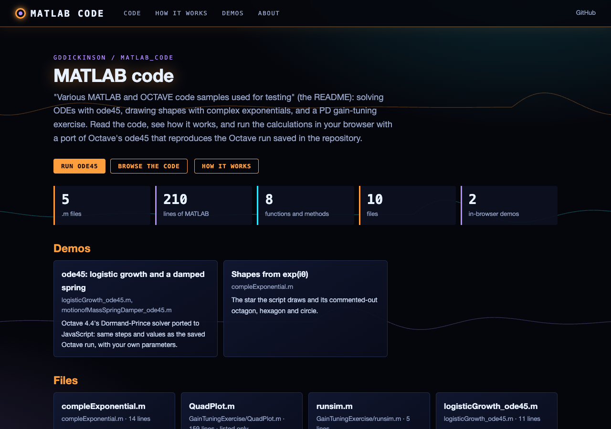
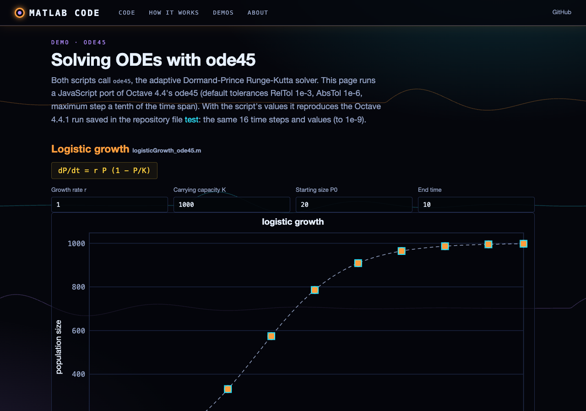
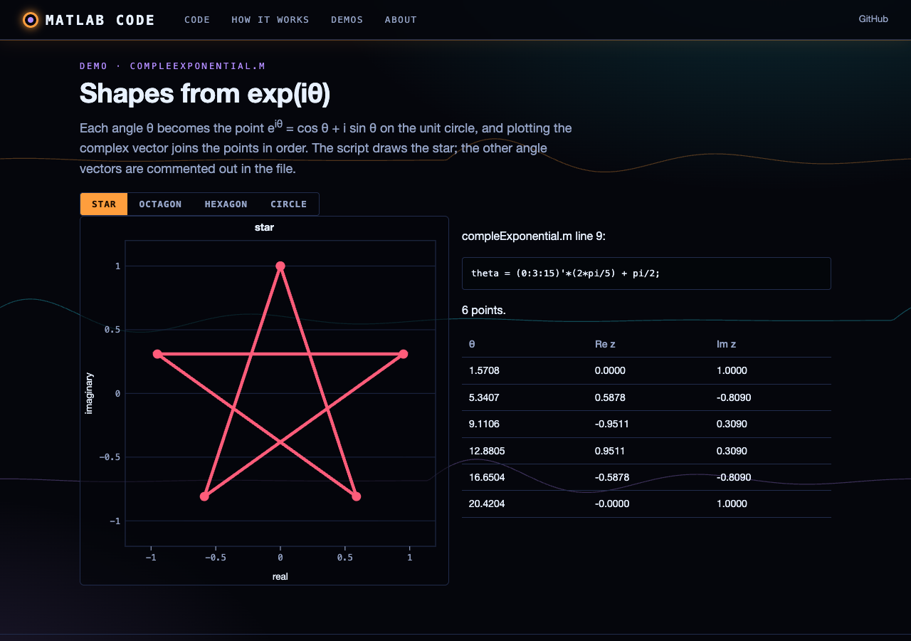
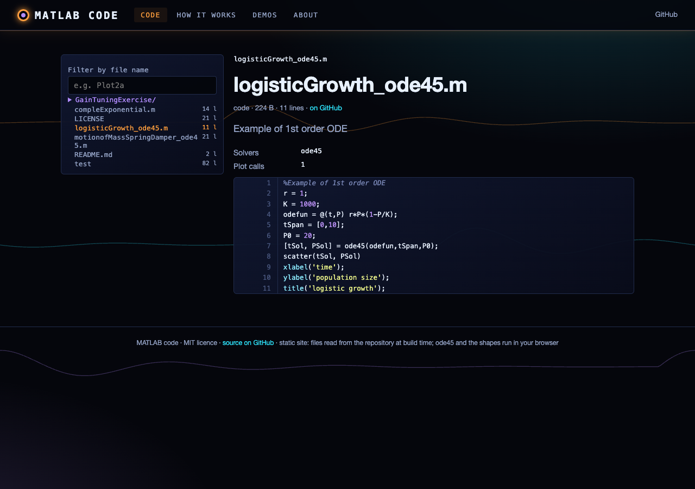

# Matlab_code
 Various MATLAB and OCTAVE code samples used for testing


## Web interface

A showcase and code explorer of this repository, with the scripts' calculations running in the browser: a port of
Octave 4.4's `ode45` that reproduces the Octave run saved in `test` (logistic growth, mass-spring-damper) and the
complex-exponential shapes: **https://gddickinson.github.io/Matlab_code/**

| Home | ode45 | Shapes | Code |
|---|---|---|---|
|  |  |  |  |

```bash
pip install -r requirements-web.txt
python run_web.py            # http://127.0.0.1:8255
```

Tests: `python -m pytest tests` and `node web/static/ode45_engine.test.mjs`. File map: `INTERFACE.md`.
